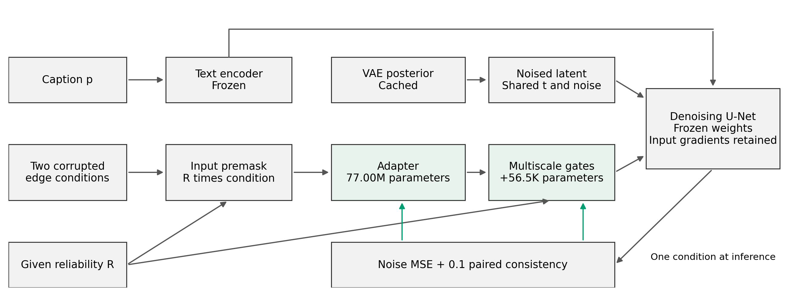
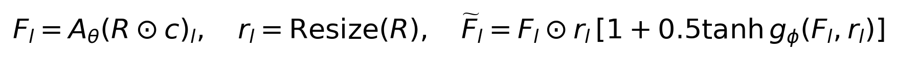
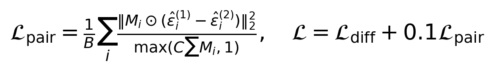
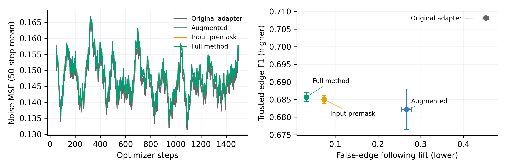
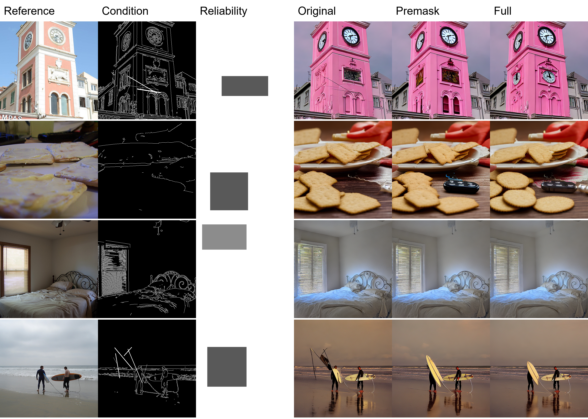

# 局部可信度引导的边缘条件图像生成

基于 T2I Adapter 的微调复现 对照实验与机制诊断

**摘要** 针对边缘条件中局部错误被生成模型复制的问题，本项目实际微调 T2I-Adapter，并实现显式可信度输入、多尺度特征门控和配对去噪约束。四种主配置各运行两个训练种子，另有两个单种子消融，在 400 张冻结测试图上生成 12,000 张图像。完整方法的错误跟随提升量由原基线的 0.4522 降至 0.0325；共享同一可信度的输入预掩码为 0.0739。相对预掩码的配对差值为 -0.0414，但可信轮廓 F1 未显示明确改善，且低于原基线。消融未证明学习门控或配对项具有稳定的独立收益。本实验支持局部特征衰减的作用，也说明复杂机制的必要性仍不足。

## 1 任务与研究问题

文字可以指定图像中的场景和物体，边缘条件则提供轮廓与空间布局。实际使用时，条件图可能同时包含已确认的轮廓和不可靠的笔画。例如，一幅体育场景的边缘图中，天空区域被意外添加数条斜线，生成模型可能把它们解释为旗帜、遮阳布或其他真实结构。简单降低整张条件图的控制强度，又可能削弱其他区域的布局约束。本项目研究在局部可信度已给定时，如何减轻错误条件的影响，并检验新增机制是否超过简单的输入预掩码。

项目选择 T2I-Adapter 的正式 AAAI 2024 主轨论文作为主论文。其出版信息为 Proceedings of the AAAI Conference on Artificial Intelligence 38(5)，4296-4304，DOI 10.1609/aaai.v38i5.28226。该会议属于 CCF 推荐目录 A 类，发表年份处于课程要求的近三年范围内。主论文的资格以正式出版记录和主轨录用清单为依据，而非以 arXiv 首发年份代替正式发表年份。

任务输入由文本 p、边缘条件 c 和外部给定的局部可信度图 R 构成，输出为 512 像素图像。训练时使用照片提取的 Canny 边缘作为草图代理，并在已知矩形区域内注入错误笔画、局部移位或擦除。可信度是实验控制系数，不解释为经过校准的正确概率；本实验也不声称解决了真实自由手绘的全部抽象与失真问题。

研究假设分为两层。第一，原适配器在局部条件出错时会复制错误结构，而同等预算的数据增强未必足以消除这一问题。第二，在共享同一可信度信息后，多尺度特征门控和配对去噪约束可能提供超过输入预掩码的收益。第二层假设必须通过强基线与消融验证；原方法与完整方法之间出现差异，并不能单独证明新增学习机制有效。

这一问题具有可证伪性：如果原适配器不受所构造干预影响，错误复制的研究动机便缺少支持；如果完整方法只因全面忽略条件而降低错误跟随，同时破坏可靠轮廓，也不能视为成功。应联合评价错误抑制、可信布局保持和文本一致性，而非挑选单一改善指标。

## 2 原方法与复现范围

T2I-Adapter 通过轻量适配器将外部视觉条件映射为多尺度特征，再将这些特征注入预训练扩散模型。生成骨干保持冻结，适配器通过生成任务的训练目标更新。本项目从公开的 SD1.5 与作者 sketch v2 Adapter 初始化，实际微调约 7,700 万个适配器参数，不以仅加载现成权重推理代替复现。图像生成仍由扩散模型逐步去噪完成。[1]

运行实现基于 Diffusers 0.30.3 自行组织训练循环。作者仓库的 SD 分支用于核对训练入口、预训练加载和适配器结构，精确参考提交为 16bba674b472121d5a86e3ed6b935f91d516bc74。作者脚本提供适配器微调加载参数与训练器入口；本项目并未直接运行作者完整的数据和训练流水线，也未完成与作者原实现逐层逐位数值等价的验证。

复现差异包括：采用 8,000 张 COCO 图像进行有限预算微调；照片中心裁剪后缩放至 512；使用固定阈值 100 和 200 的白色 Canny 边缘，而非作者完整 sketch 预处理；采用 BF16 计算和梯度检查点。本项目不将小规模微调得到的 FID 与主论文完整训练的公开数字混比。

VAE、文本编码器和 U-Net 权重冻结。缓存只保存 VAE 后验均值、对数方差与文本特征，训练时继续采样后验噪声，因此不是把每张照片固定成唯一 latent。冻结 U-Net 也不等于对其前向使用无梯度上下文：从噪声预测到适配器残差之间的梯度路径必须保留，才能更新适配器与门控。

SmartControl 已利用生成先验识别文本与粗糙条件的冲突，并预测逐位置控制尺度，说明空间权重不是新思想。[2] 本项目不估计图文冲突，而假定 R 已给定，检验两次受控干预及其训练约束。SketchingReality 强调自动边缘与真实自由手绘的区别，采用语义调制和不依赖像素对齐的训练处理手绘。[3] 本实验仍使用可对齐边缘和合成扰动，不能据此声称优于这些方法的真实手绘表现；目前也没有实际复现直接近邻方法的完整训练对照。

训练数据流。绿色模块可训练；冻结的 U-Net 仍向条件特征传播梯度。推理只需要单份条件，适配器与门控特征在去噪循环前计算。

## 3 改进机制与训练目标

输入预掩码先将条件乘以 R，抑制低可信区域。由于适配器包含卷积与非线性运算，仅在输入端缩放并不等价于控制每一层的条件特征。完整方法将 R 按面积插值到各特征尺度，并以适配器特征和可信度为输入预测一个单通道调整量。门控采用两个 1×1 卷积和 SiLU，中间通道数为 16，末层零初始化。新增参数共 56,516 个。

设适配器参数为 theta，门控参数为 phi。下式定义特征注入权重。该权重允许围绕给定可靠性进行有限调整，不强制将其解释为概率。R 为零时相关特征被抑制；在下采样后可信度为 1 的位置，零初始化调整量保留原始特征，训练后也可能被调整，因此是否保持可信轮廓需要实测。

配对训练对同一目标照片构造两份局部干预条件，共享目标 latent、扩散时刻、噪声和文本。配对项比较两次噪声预测在可信区域中的差异。掩码先缩放到 latent 分辨率，再将不可信区域向外扩张两个 latent 像素，避开边界。分母按图像单独归一化，再求批量均值，使改变微批量大小不会改变样本加权方式。空可信区域的分母至少取 1。

总损失为两份条件的平均去噪 MSE 加 0.1 倍配对项。所有训练配置均处理两路条件；原基线使用两份相同干净条件，以控制处理次数。推理不需要第二份干预条件，也不额外运行一致性网络。空间控制强度已有 SmartControl 等相关研究，本项目将此设计定位为针对显式可信度输入的局部修改，而不将门控本身宣称为首次提出的机制。

## 4 数据划分与冻结实验协议

训练集为 COCO train2017 中固定选取的 8,000 张图像，开发集为 val2017 中 400 张图像，另有 1,200 张独立测试候选图像。划分先按 image ID 排序，再使用种子 20261108 打乱；各集合 image ID 无交叠，每张图固定采用按标注 ID 排序的第一条 caption。代码保存实际清单及文件校验值，而非仅依赖未来再次运行随机划分。[4]

矩形干预区域的高和宽分别从图像边长约五分之一至二分之一范围采样。区域内的可信度取 0、0.15、0.35 或 0.55，外部为 1。干预包括六条随机笔画、范围内的局部循环移位，以及随机擦除边缘。两份干预共享区域、可信度与干预类型，但具体扰动不同。可信图来自已知的合成干预位置，并非模型自行识别错误。

正式测试在读取结果前冻结为测试清单的前 400 张，其余 800 张保留未用于本轮评价。每张图生成干净条件和两个干预条件共三张图，使用同一文本、同一可信图与相同初始噪声。DDIM 采样为 25 步，CFG 为 7.5，图像噪声种子由固定基种子 2026 与 image ID 确定。开发集用于诊断；测试集不用于选择损失权重和训练步数。

| 项目 | 冻结配置 |
|---|---|
| 训练 | 8,000 图，1,500 步，全局 batch 8，micro batch 4 |
| 优化 | AdamW，lr 1e-5，weight decay 0.01，梯度裁剪 1 |
| 精度 | BF16，U-Net 冻结并保留输入梯度，梯度检查点 |
| 生成 | 400 图，每图 3 视图，DDIM 25 步，CFG 7.5 |

四个主配置各运行训练种子 42 和 43。原基线微调原适配器；增强基线使用相同干预；预掩码基线额外共享 R；完整方法加入多尺度门控和配对项。两个消融仅使用种子 42，分别去除配对项和用固定可信度替换学习门控。因此消融应与完整方法的种子 42 对照，不能直接拿单种子结果与双种子平均混比。

## 5 主实验与评价口径

可信轮廓 F1 在 R 为 1 且避开边界的区域比较生成边缘与参考边缘，采用两像素匹配容差。它衡量可靠约束是否被保留，而非自然度本身。错误跟随提升量先找出干预新增、参考条件中不存在的笔画，再比较干预生成图与同模型干净条件生成图对这些笔画的覆盖差异；该差值用于减轻自然边缘偶然重合的影响，越低越好。没有新增笔画的擦除样例不计入这一指标。

辅助评价包括离线 CLIP 图文余弦相似度、KID 和 Clean-FID。CLIP 数值是余弦值，不与其他缩放定义的 CLIP Score 混用。分布指标使用每张图的第一个干预视图与同数目的参考图，FID-400 具有明显小样本偏差，仅用于本协议的相对诊断，不与 FID-50K 或公开完整训练结果排名比较。[5]

主表逐种子计算，再报告两次训练的均值和标准差。标准差只基于两次训练，不能提供充分的跨训练随机性置信保证。配对比较按相同图像和输入匹配，图像 bootstrap 将同一图像的两份干预保留在同一簇中。主结果保留全部生成输出和安全过滤标记；共同剔除任一方法过滤图像的分析另列为敏感性分析。

| 方法 | 可信边缘 F1 ↑ | 错误跟随 ↓ | CLIP ↑ | KID×1000 ↓ | FID-400 ↓ |
|---|---|---|---|---|---|
| 原适配器 | 0.7081 ± 0.0006 | 0.4522 ± 0.0065 | 0.3082 ± 0.0005 | 0.3611 ± 0.0056 | 97.2689 ± 0.1964 |
| 同增强基线 | 0.6822 ± 0.0058 | 0.2669 ± 0.0117 | 0.3085 ± 0.0001 | 0.6517 ± 0.0011 | 98.0393 ± 0.8958 |
| 输入预掩码 | 0.6850 ± 0.0011 | 0.0739 ± 0.0033 | 0.3087 ± 0.0004 | 0.3047 ± 0.0821 | 98.6433 ± 0.9370 |
| 完整方法 | 0.6857 ± 0.0014 | 0.0325 ± 0.0009 | 0.3098 ± 0.0002 | 0.2859 ± 0.0672 | 97.4868 ± 0.0335 |

训练曲线仅反映去噪目标；右图联合展示错误抑制与可信轮廓保持，避免只选择单一有利指标。误差线为两个训练种子的标准差。

## 6 消融与失效模式诊断

输入预掩码是关键替代解释。若完整方法只优于原基线，却不能稳定优于共享 R 的预掩码，则改善可能主要来自新增的可靠性信息或直接抑制输入。本项目保留这一强基线，而不把所有收益都归因于门控学习或配对目标。固定门控进一步区分显式的多尺度衰减与学习调整量的作用；去除配对项则检验该训练约束的附加价值。

| 配置（种子 42） | 可信边缘 F1 ↑ | 错误跟随 ↓ | CLIP ↑ |
|---|---|---|---|
| 完整方法 | 0.6867 | 0.0331 | 0.3099 |
| 去除配对项 | 0.6856 | 0.0317 | 0.3098 |
| 固定门控 | 0.6821 | 0.0319 | 0.3094 |

诊断须分开看新增笔画、移位和擦除，以及不同可靠性系数。R 为零时，预掩码已经完全移除相关输入，属于重要的简单对照；不能只在这些容易样例上证明复杂机制有效。配对项的原始数值与去噪 MSE 的量级也应同时报告，但损失值较小本身不能直接证明其梯度无效。

32 张开发图预试验表明原方法确实可能复制注入斜线，预掩码已解释大部分错误抑制。完整方法的附加差异较小，且一个被安全过滤的图像影响了部分平均指标。因此正式主表保留这些输出，同时采用对全部方法共同排除过滤图像的对称敏感性分析；不能仅删除某个方法的不利样例来制造改善。

正式结果表明，完整方法相对预掩码的错误跟随提升量差值为 -0.04137，图像簇重采样 95% 区间为 [-0.05358, -0.02827]；该指标覆盖 260 张确有新增笔画的图像。可信轮廓 F1 差值为 +0.00069，区间 [-0.00362, +0.00530]，不能证明保持能力有所改善。相对原基线，F1 反而下降 0.02245，说明错误抑制伴随布局保持的代价。按 R 分组，R=0 时两种可靠性方法的错误跟随均为零，符合完全删除相关输入的预期；差异主要出现在非零 R，尤其 R=0.35 和 0.55。种子 42 的固定门控和去配对项版本，其错误跟随值分别为 0.03187 和 0.03174，均未劣于完整方法的 0.03312；各自与完整方法的 F1、CLIP 和错误跟随差值区间均跨零。因而不能把完整设计中的每一项都列为有效贡献。共同排除 15 张任一配置被安全过滤的图像后，完整方法相对预掩码的错误跟随差值仍为 -0.04584，区间 [-0.05724, -0.03513]；F1 差值转为 -0.00222，区间跨零，CLIP 差值 +0.00060 的区间也跨零。因此文本一致性的微小优势对过滤样例敏感，可靠性保持改善尚未得到支持。

| R | 图像数 | 预掩码跟随 | 完整方法跟随 | F1 差值 |
|---|---|---|---|---|
| 0.0 | 97 | 0.0000 | 0.0000 | -0.0025 |
| 0.15 | 96 | 0.0296 | 0.0197 | -0.0003 |
| 0.35 | 113 | 0.0803 | 0.0272 | +0.0023 |
| 0.55 | 94 | 0.1778 | 0.0807 | +0.0031 |

## 7 相同输入的生成案例

下图按冻结测试清单的固定顺序展示同输入案例，列出参考照片、干预边缘、可信图以及原基线、预掩码和完整方法。所有输出采用相同文本与图像噪声种子。参考照片用于说明任务与计算指标，不是推理输入；生成模型接收的是文本和条件图。

定性比较需要同时检查三件事：错误笔画是否形成了不应出现的结构，可信区域的轮廓是否仍被保留，以及文本语义和整体图像是否合理。单个漂亮案例不能替代全量统计。额外展示的明显改善或失败样例只能用于解释失效机制，须明确其选择方式。

固定测试案例。R 的深色区域为较低可信度；原方法忽略 R，预掩码与完整方法都获得同一可靠性信息。主文保留原方法与强简单基线，避免只比较两个差异最大的版本。

固定前四个案例同时包含成功与失败。冲浪场景中，原基线将额外笔画解释为细杆或旗帜样结构，预掩码与完整方法有所减轻，但这一单例不足以区分二者。钟楼案例中完整方法仍生成多余钟面；餐桌案例中预掩码与完整方法出现参考照片中没有的黑色小物体；卧室案例的方法差异较小。这些现象说明抑制错误控制不等同于消除生成幻觉，也不能保证目标照片的细节重建。案例按测试清单固定顺序选取，没有根据方法优劣重新排序。

## 8 资源 复现边界与结论

实验在校内四张 RTX 4090 上以每卡一个独立配置运行。两卡 DDP 已通过项目级训练验收，但本轮优先并行不同配置与种子，以缩短完成对照实验的墙钟时间。微批量测速保持全局 batch 为 8：微批量 1、2、4 和 8 的稳态中位步时分别约 1.81、0.96、0.63 和 0.62 秒。选择微批量 4，以较小显存获得与 8 接近的速度；该工程选择不计作科研创新。

训练配置、逐步日志、包含优化器状态的检查点、模型版本和数据清单均保存。检查点恢复、适配器与门控实际参数更新、离线 CLIP 以及 Inception 特征提取均进行了真实验收。源码与公开资源清单支持重新获取同一预训练版本和划分；单纯冻结随机种子并不保证不同硬件与软件版本逐位一致。

| 项目 | 实测 |
|---|---|
| 硬件 | 4×RTX 4090 24GB；Torch 2.2.2 / CUDA 12.1 |
| 每次训练 | 平均 16.35 分钟，最大已分配显存 9.97 GiB |
| 总流程 | 训练阶段约 49.9 分钟；训练、生成、评测约 108.7 分钟 |

配对方法对每张目标图处理两路条件。为匹配处理次数，原基线也使用了两份相同条件；本表因而不是原作者常规单条件训练吞吐的一对一比较。相较单条件训练，配对设计仍有额外去噪计算，不能用预算匹配后的相近耗时宣称这部分开销不存在。

本项目的主要边界是：仅验证一个 SD1.5 骨干和合成边缘条件；可信区域的位置已知，尚未测试自动估计可信度或真实手绘；仅有两个主实验训练种子；测试分布指标的样本量较小。微调集合虽与本组测试集合 image ID 分离，也不能排除基础模型在预训练阶段见过相关网络图像。

本轮 10 次训练平均每次 16.35 分钟，峰值已分配显存最大 9.97 GiB；四卡并行的正式训练阶段约 49.9 分钟，训练、生成与评测总流程约 108.7 分钟，不含先期资源下载、部署、试验和备份。所有配置都完成 1,500 步微调，已形成可核查的对照、消融和同输入生成证据。结果支持给定可信度下的输入与特征抑制能够减轻错误条件跟随，但大部分改善可由简单方案解释，学习门控及配对约束的独立增益未得到证明。为遵守时间预算，本轮停止追加训练；课程报告保留失败证据。若继续科研，应先验证带噪或人工给定 R 的真实手绘，并与固定特征门控做多种子对照，再决定是否需要复杂学习机制。

现有实验可以用于课程级方法复现、改进检验和失败分析。独立论文尤其顶会投稿还需要更强的新颖性证据、真实手绘与可靠性标注、直接近邻方法比较及跨骨干验证。局部空间控制强度已有先行工作，少量正向实验不构成首次提出该思想或达到顶会竞争力的证据。

## 参考文献

[1] Mou C, Wang X, Xie L, et al. T2I-Adapter: Learning Adapters to Dig Out More Controllable Ability for Text-to-Image Diffusion Models. AAAI, 2024, 38(5): 4296-4304. DOI: 10.1609/aaai.v38i5.28226.

[2] Liu X, Wei Y, Liu M, et al. SmartControl: Enhancing ControlNet for Handling Rough Visual Conditions. ECCV, 2024. https://www.ecva.net/papers/eccv_2024/papers_ECCV/papers/06412.pdf

[3] Bourouis A, Bessmeltsev M, Gryaditskaya Y. SketchingReality: From Freehand Scene Sketches to Photorealistic Images. ICLR, 2026. https://proceedings.iclr.cc/paper_files/paper/2026/hash/ea34f9c3acb3de6fa29582ff469bcd6b-Abstract-Conference.html

[4] COCO Consortium. Common Objects in Context dataset. https://cocodataset.org/#download

[5] Parmar G, Zhang R, Zhu J Y. On Aliased Resizing and Surprising Subtleties in GAN Evaluation. CVPR, 2022. https://github.com/GaParmar/clean-fid
